<div align="center">


# HeriTech

### Festival waste, *traced* into heritage craft.

A circular digital system that logs festival leftovers when they're collected, routes them to local artisans, and gives every finished piece a public record of where it came from and who got paid.

[**Live demo**](https://heritech-demo.vercel.app) · [How it works](#how-it-works) · [Tour](#a-quick-tour) · [Google technology](#built-on-google) · [Run it locally](#getting-started)


<br />

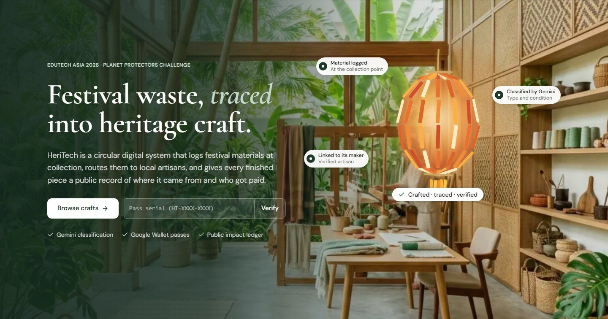

<sub>The home page hero. Hover it and the scattered leftovers assemble into a lantern, the way the system turns waste into a traceable piece.</sub>

</div>

---

## Overview

Festivals across Asia leave tonnes of paper, bamboo, fabric and flowers behind every year. Some of it could become something worth keeping, but it usually ends up in landfill. The material has no record and the artisans who could use it can't find it. Buyers who want to support "upcycled" goods have no way to check the claim.

**HeriTech connects the three people who can fix this, and gives each of them a reason to take part:**

| Who | What HeriTech gives them |
| --- | --- |
| **Local government officers** | A fast way to log and classify what they collect, plus **25%** of every sale made from it |
| **Artisans** | A map of free, classified material near them, safe pickup, and **70%** of every sale |
| **Buyers** | Crafts with a **Verified Impact Pass**: a public, scannable record of the material, the maker and the money |

The remaining **5%** goes to charity and keeping the app running. The split is shown before anyone pays, and it's the same on every screen.

### The problem, in numbers

<table>
<tr>
<td width="33%" valign="top">

**50,000+**<br />
sky lanterns released in a single night at Yi Peng, Chiang Mai (2017)

<sub>Source: Khaosod English</sub>

</td>
<td width="33%" valign="top">

**508 tonnes**<br />
of floral offerings collected in Mumbai after Ganesh Chaturthi 2025

<sub>Source: Greater Kashmir</sub>

</td>
<td width="33%" valign="top">

**30+ tonnes**<br />
of temple flower waste processed every day by a single company in India (Phool.co, 2025)

<sub>Source: YourStory</sub>

</td>
</tr>
</table>

That last number shows the material has value once someone collects it. HeriTech makes that collection traceable, so the value goes back to the communities that made the festival happen.

---

## How it works

<p align="center">
  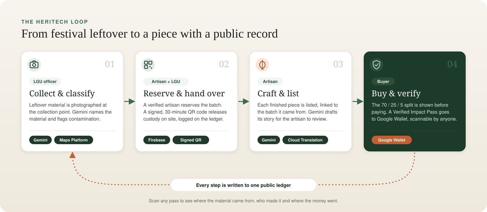
</p>

1. **Collect & classify.** A local government officer signs a material release agreement, photographs the collected material and lets **Gemini** name it, rate its condition and flag contamination (tape, wax, moisture, wire…). The officer weighs it and logs the batch at its location on the map. If Gemini can't be reached, an on-device **Teachable Machine** model gives a clearly labelled estimate instead.
2. **Reserve & hand over.** A verified artisan finds the batch on the **material map** and reserves it, and the logging officer is notified. At pickup, the artisan shows (or downloads, or shares) a **signed QR code that is valid for 30 minutes**. The officer scans it with the camera or imports a photo of it, and custody moves to the artisan. Each step is logged.
3. **Craft & list.** The artisan lists the finished piece, linked to the batch it came from. **Gemini** drafts a short story about the piece for the artisan to edit. **Cloud Translation** lets buyers read the shop in their own language.
4. **Buy & verify.** At checkout the buyer sees exactly where the money goes: **70% artisan, 25% local government, 5% charity & app upkeep**. Each piece comes with a **Verified Impact Pass** that can be saved to **Google Wallet**. Its QR code opens the piece's public record at `/verify/<serial>` for anyone who scans it, no account needed.

> **Why a public record?** "Made from recycled materials" is easy to claim. The pass lets a stranger check it: what was collected, where, when it changed hands, who made the piece, and how the payment was split.

---

## A quick tour

### The signature moment

<table>
<tr>
<td width="50%">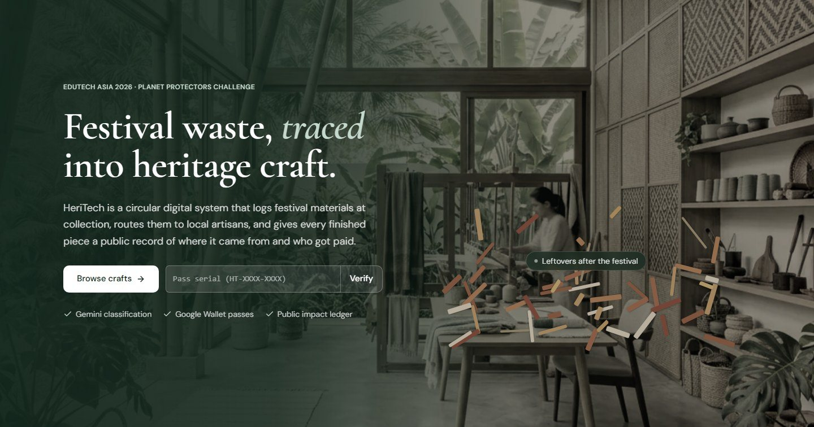</td>
<td width="50%"></td>
</tr>
<tr>
<td align="center"><sub><b>Before:</b> the leftovers as they're collected</sub></td>
<td align="center"><sub><b>After:</b> hover, and they become a lantern with a record</sub></td>
</tr>
</table>

### Shop and product story

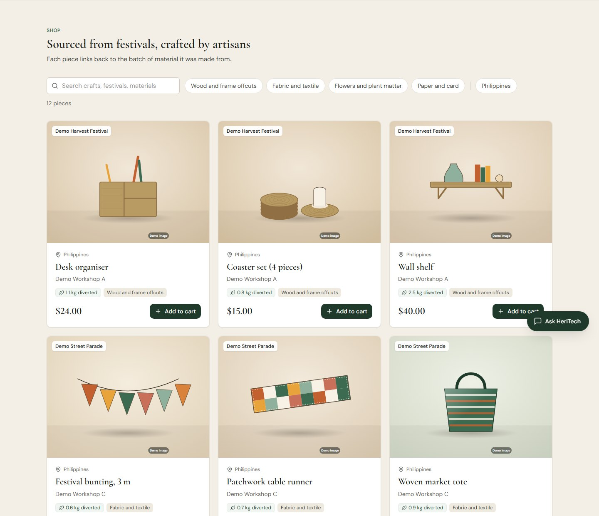

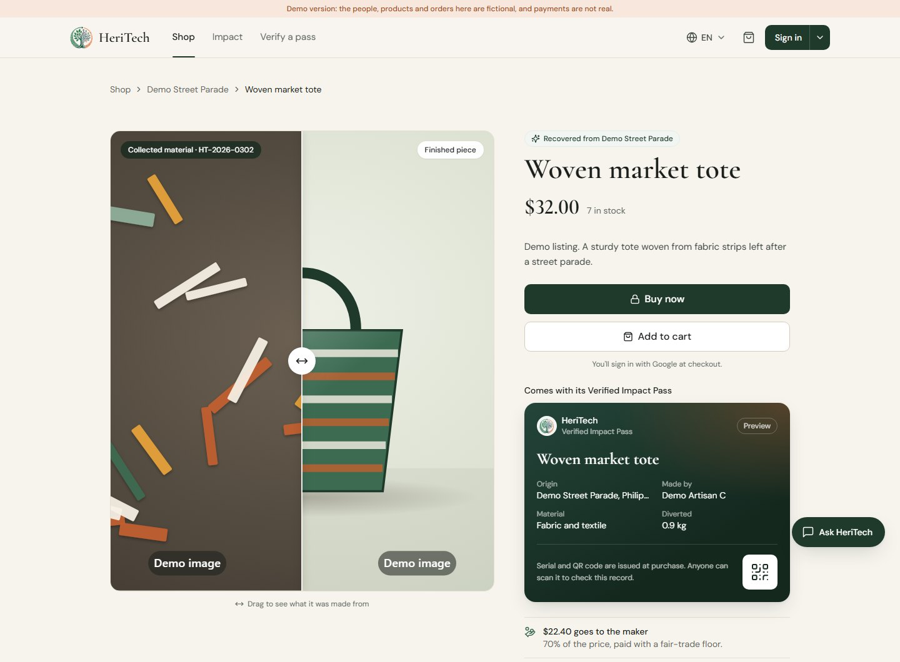

<sub>Every product page has a before/after slider (collected material → finished piece), the provenance timeline, the money split and a preview of the pass the buyer will receive.</sub>

### Pickup: the QR handover

<table>
<tr>
<td width="38%" valign="top">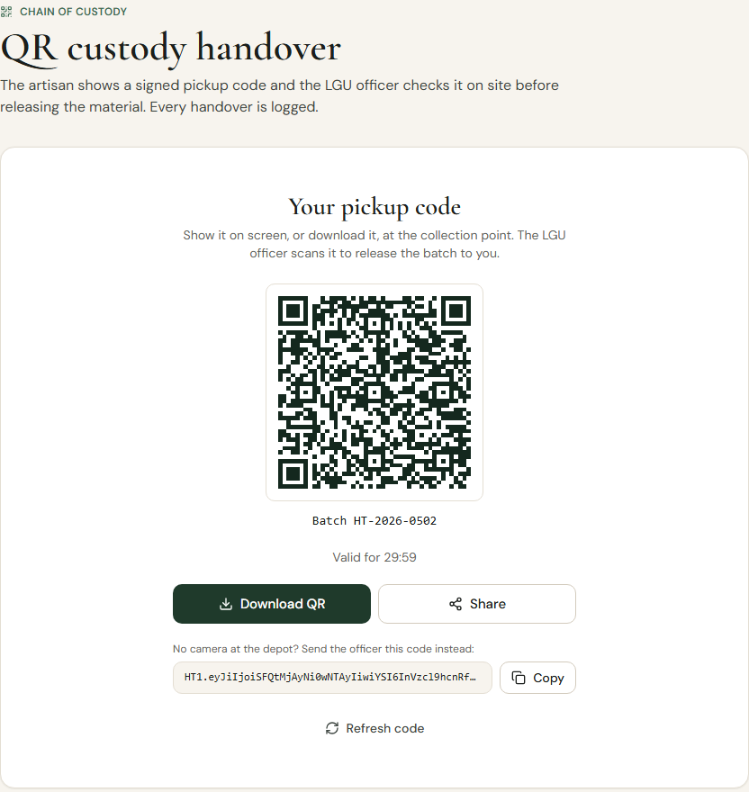</td>
<td width="24%" valign="top">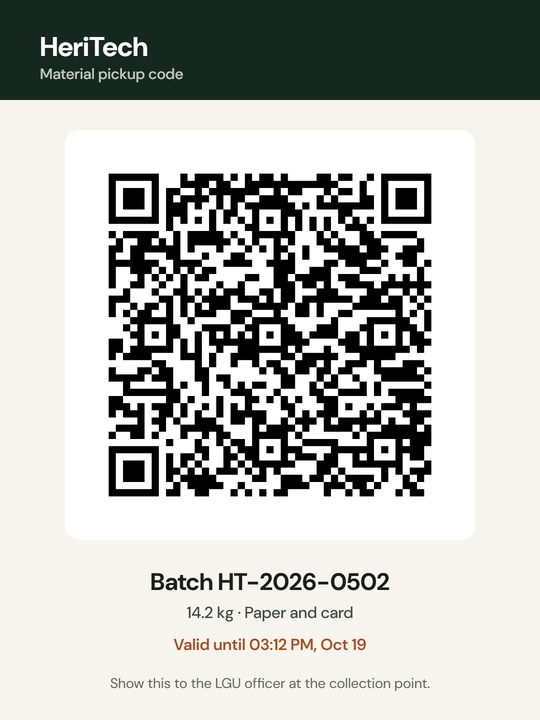</td>
<td width="38%" valign="top">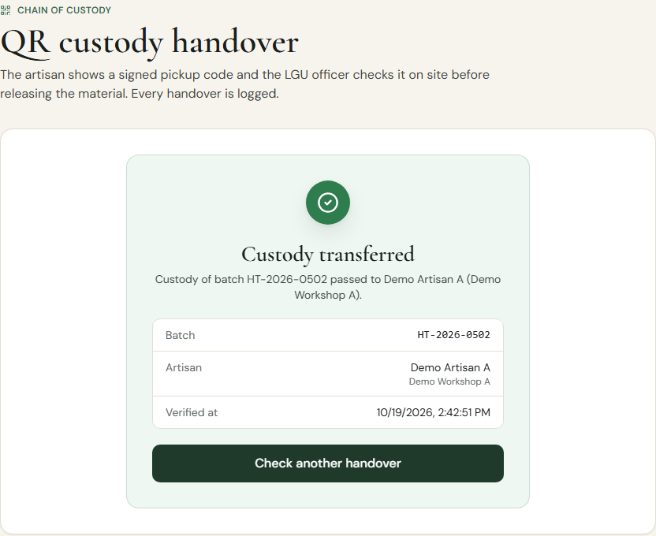</td>
</tr>
<tr>
<td align="center"><sub><b>Artisan</b> shows a signed code that expires after 30 minutes</sub></td>
<td align="center"><sub>…or downloads it as a pickup card</sub></td>
<td align="center"><sub><b>Local government officer</b> scans or imports a photo, and the batch is handed over</sub></td>
</tr>
</table>

The codes are HMAC-signed and tied to one batch and one artisan, so a screenshot can't be reused once it expires. The scanner uses the browser's native `BarcodeDetector` and falls back to `jsQR`. It was tested on tilted, dim, blurry and compressed phone photos.

### The Verified Impact Pass

<table>
<tr>
<td width="40%" valign="top">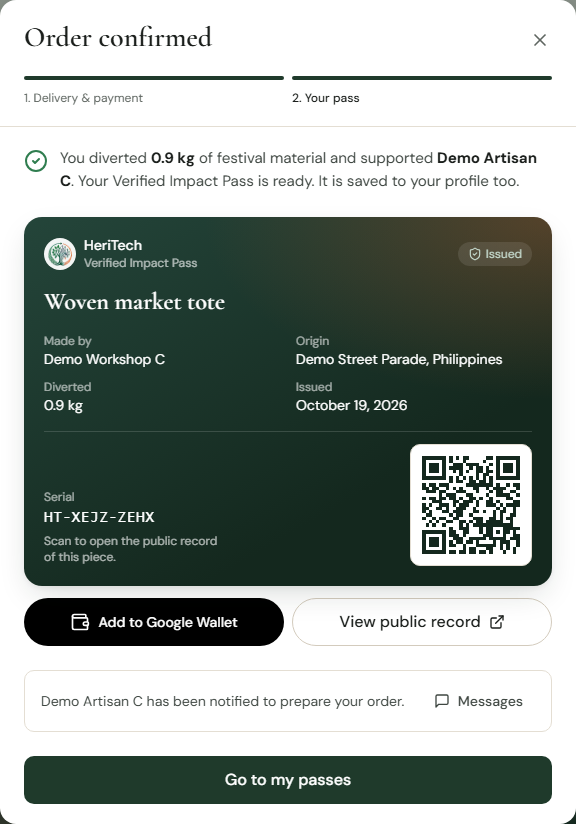</td>
<td width="30%" valign="top">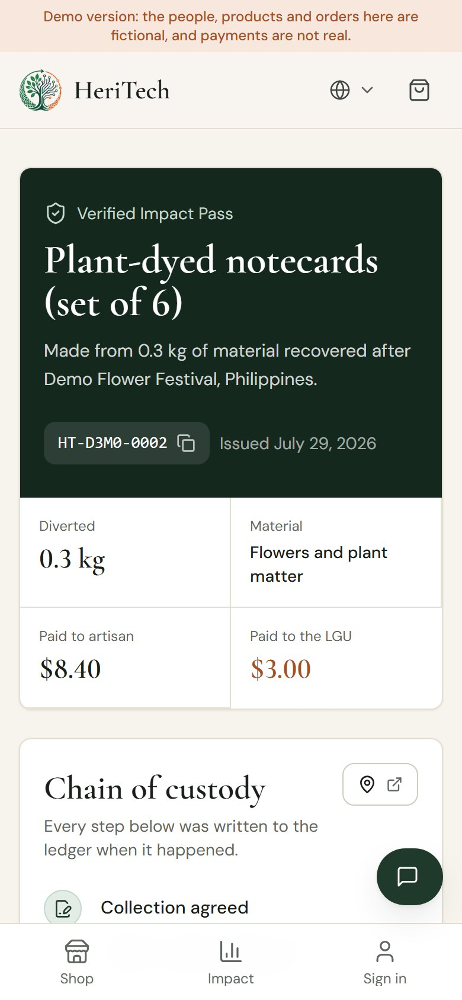</td>
<td width="30%" valign="top">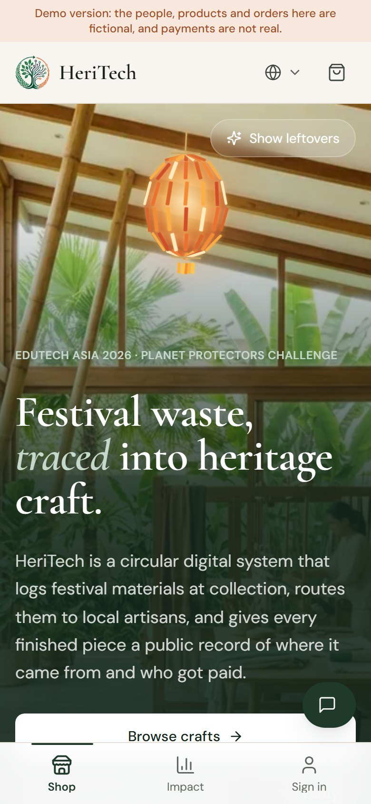</td>
</tr>
<tr>
<td align="center"><sub>The pass appears as soon as the order is placed, and in the buyer's profile</sub></td>
<td align="center"><sub>Scanning it opens the public record. It's built for phones, since that's where people scan.</sub></td>
<td align="center"><sub>The whole app works on a phone</sub></td>
</tr>
</table>

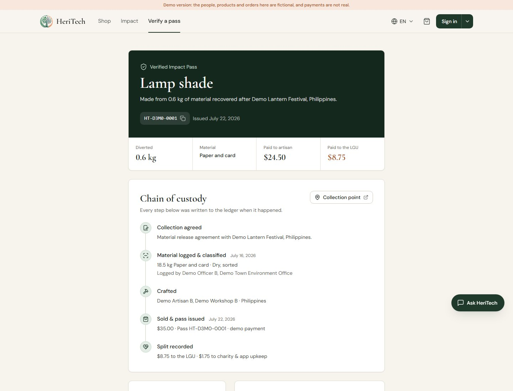

### The public impact record

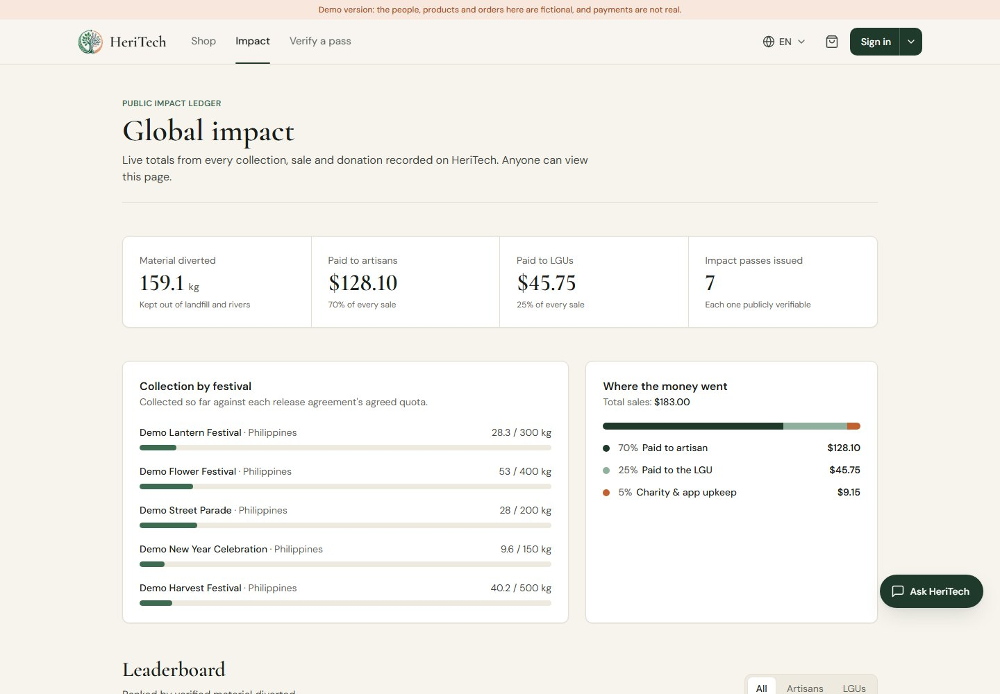

---

## Built on Google

Every Google tool listed here does a job in the loop. Without it, that step breaks.

| Technology | What it does in HeriTech | Without it |
| --- | --- | --- |
| **Gemini API** | Classifies material from a photo (type, condition, contamination), drafts product stories, powers the "Ask HeriTech" assistant | Officers would have to sort and label waste by hand, which nobody has time for at a festival clean-up |
| **Google Maps Platform** | The material map: where each batch was collected and what's available near an artisan | Artisans can't find material, so it isn't reused |
| **Google Wallet API** | Each sale issues a Verified Impact Pass (an RS256-signed save link) that lives on the buyer's phone | The proof stays in an inbox nobody opens |
| **Firebase** (Auth + Firestore) | Google sign-in, roles, and the records themselves, with transactions for reservations, handovers and stock | — |
| **Cloud Translation** | Reads the shop and app in the buyer's language (falls back to Gemini, then to a bundled phrase list) | A regional marketplace limited to one language |
| **Teachable Machine / TensorFlow.js** | On-device backup classifier for when there's no signal at the collection point | The scanner stops working offline |

---

## Trust & architecture

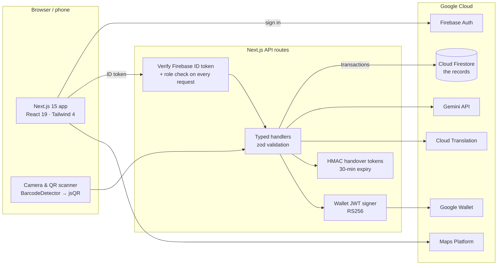

**Built to be trusted, not just shown:**

- **No direct database access from the browser.** `firestore.rules` denies all client reads and writes. Every request goes through an API route that checks the Firebase ID token and the caller's role.
- **One source of truth for money.** The 70 / 25 / 5 split is defined once in `src/lib/escrow.ts` and reused by checkout, the pass, the verify page, the impact record and the admin view.
- **Consistent under pressure.** Reservations, handovers, checkout and stock, and serial numbers all run inside Firestore transactions, so two artisans can't claim the same batch.
- **Roles are earned, not chosen.** Everyone starts as a buyer and applies from their profile ("Become a partner") to become an artisan or local government officer. An admin approves them, and nobody can change their own role.
- **Nothing gets stuck.** A reservation lasts 48 hours; the artisan can cancel it and an admin can release it. Every Impact Pass recomputes its batch's hash, so the public record shows whether the collection details were edited.
- **Honest by design.** Payments are simulated and the UI says so. AI output is labelled, and the demo deployment carries a banner saying its data is fictional.
- **Accessible and responsive.** Keyboard focus rings, reduced-motion support on every animation, 12px minimum text, and layouts tested from 390px phones to 1440px displays. Text can be shown in several Asian languages.

### Tested

| Check | Result |
| --- | --- |
| Unit tests (`vitest`): split maths, loyalty, handover tokens, reservation expiry, record integrity, Wallet links, HTTP helpers | ✅ 61 passing |
| End-to-end API tests against the Firebase emulators | ✅ 89 checks passing |
| TypeScript (`tsc --noEmit`) and ESLint | ✅ 0 errors |
| QR import robustness: tilted, dim, blurred and compressed phone photos, and a photo with no code | ✅ all decode or are correctly rejected |

---

## Try it

**Live demo: [heritech-demo.vercel.app](https://heritech-demo.vercel.app)**

The demo has one-click sign-in for each role, so you can walk the whole loop in a few minutes:

| Sign in as… | Try this |
| --- | --- |
| **Buyer** | Open a product → **Buy now** → place a demo order → see your Verified Impact Pass → scan its QR with your phone |
| **Artisan** | **Material map** → reserve a batch → **Hand over** → download the pickup QR |
| **Local government officer** | **Scanner** to classify a photo with Gemini → **Hand over** to scan or import the artisan's QR |
| **Admin** | Review partner applications and all records |

Or skip signing in: enter **`HT-D3M0-0001`** in *Verify a pass* on the home page.

> All people, products and orders in the demo are fictional, and no real payment is taken.

---

## For developers

The sections below are for running and deploying HeriTech yourself.

## Stack

- Next.js 15 (App Router), React 19, Tailwind CSS 4
- Firebase Auth (Google sign-in) and Cloud Firestore through the Admin SDK
- Gemini API for the material scanner, product stories and the assistant
- Google Cloud Translation (falls back to Gemini, then to a bundled phrase list)
- Google Maps Platform for the material map, Google Wallet API for impact passes

## Architecture

- The browser only talks to Firebase **Auth**. All data goes through the API routes in `src/app/api`, which verify the caller's Firebase ID token (`src/lib/server/auth.ts`) and check their role on every request. `firestore.rules` denies all direct client access.
- Firestore access is typed (`src/lib/server/firestore.ts`). Relations are stored as ids and joined in `src/lib/server/views.ts`. Anything that must be consistent — reservations, handovers, checkout and stock, id sequences — runs in a transaction.
- Request bodies are validated with zod; errors come back as `{ success: false, error }` with the right status code.
- Roles: `buyer` (default for new accounts), `artisan`, `lgu`, `admin`. People apply from their profile and an admin approves them. Nobody can change their own role.
- Every sale is split **70% artisan / 25% local government / 5% charity & app upkeep** (`src/lib/escrow.ts` is the single source of truth). Payments are **simulated** — no payment provider is connected yet, and the UI says so.

## Getting started

```bash
npm install
cp .env.example .env   # then fill it in
npm run check:firebase # confirms the credentials work (read-only)
npm run dev
```

The real project starts empty: it only ever holds records people create. The fictional showcase data is for the demo project only (see Demo mode).

### Environment variables

See `.env.example` for the full list. The important ones:

| Variable | Purpose |
| --- | --- |
| `NEXT_PUBLIC_FIREBASE_*` | Web app config from Firebase console → Project settings |
| `FIREBASE_SERVICE_ACCOUNT_KEY` | Service account JSON on one line (server only) |
| `HANDOVER_TOKEN_SECRET` | Random string, 32+ characters, signs pickup QR codes |
| `GEMINI_API_KEY` | AI scanner, stories, assistant |
| `GOOGLE_TRANSLATE_API_KEY` | Optional; translation falls back to Gemini |
| `NEXT_PUBLIC_APP_URL` | Public URL used in impact pass QR codes |
| `NEXT_PUBLIC_DEMO_MODE` | `true` only on the presentation deployment |

### The first admin

Sign in once with Google, then:

```bash
npm run set-role -- you@example.com admin
```

## Demo mode (presentations)

Set `NEXT_PUBLIC_DEMO_MODE=true` on a **separate** deployment backed by a **separate** Firebase project. It adds one-click sign-in as the seeded buyer, artisan, local government officer and admin. Those are real Firebase sessions with exactly their role's permissions — nothing is bypassed. Every page shows a banner saying the data is fictional. If Gemini is unreachable, the scanner and story writer return clearly labelled placeholder results instead of an error.

Put the demo project's settings in `.env.demo.local` (git ignores it), including `NEXT_PUBLIC_DEMO_MODE=true` and the demo site's `NEXT_PUBLIC_APP_URL`, so the seeded passes' QR codes open the demo site. Then load or reset the fictional data, for example before each presentation:

```bash
npm run seed:demo
```

The script refuses to run unless demo mode is on. The demo data is deliberately generic: materials by broad category, no real people or organisations, and labelled placeholder images from `public/demo`.

The demo product and material photos are free photos from [Unsplash](https://unsplash.com/license) (no attribution required), cropped, compressed and labelled "Demo image". They stand in for fictional listings and are not pieces made from HeriTech batches.

## Testing

```bash
npm run typecheck
npm run lint
npm test                      # unit tests
```

End-to-end API tests run against the Firebase emulators, never your real project:

```bash
npm run emulators             # terminal 1 (needs Java)
FIRESTORE_EMULATOR_HOST=127.0.0.1:8080 NEXT_PUBLIC_DEMO_MODE=true npm run seed -- --reset
FIRESTORE_EMULATOR_HOST=127.0.0.1:8080 FIREBASE_AUTH_EMULATOR_HOST=127.0.0.1:9099 \
  NEXT_PUBLIC_FIREBASE_AUTH_EMULATOR_HOST=127.0.0.1:9099 NEXT_PUBLIC_DEMO_MODE=true \
  NEXT_PUBLIC_APP_URL=http://localhost:3100 GEMINI_API_KEY= npx next dev -p 3100   # terminal 2
npm run test:e2e              # terminal 3
```

## Deploying (Vercel)

1. Add every variable from `.env.example` in Vercel → Settings → Environment Variables.
2. In Firebase console → Authentication → Settings → Authorized domains, add the Vercel domain.
3. Publish the rules and indexes: `npx firebase deploy --only firestore --project <project-id>`. The emulators don't enforce indexes, so a missing one only shows up against a real project.
4. Google Wallet: in the [Pay & Wallet console](https://pay.google.com/business/console), open Google Wallet API, copy the issuer id into `GOOGLE_WALLET_ISSUER_ID`, and under **Users** add the service account email (the Firebase one, or a dedicated one in `GOOGLE_WALLET_SERVICE_ACCOUNT_EMAIL`). While the issuer is in demo mode, add every judge's and teammate's Google account as a test user.
5. Google Maps: enable the **Maps JavaScript API** for the key in Google Cloud Console and restrict the key to your domains.
6. Optional: enable Cloud Storage (requires the Blaze plan). Until then, uploaded photos are compressed and stored inline, capped well below Firestore's 1 MiB document limit.

## Not built yet

We'd rather say it than have a judge find it:

- Real payments and payouts (Stripe Connect or similar)
- Google Wallet publishing access (passes work for test users while the issuer is in demo mode)
- Offline queue for field officers

---

<div align="center">


&nbsp;&nbsp;&nbsp;&nbsp;


**Made at the University of the Assumption, Pampanga, Philippines**<br />
for **EDUtech Asia 2026 · Planet Protectors Challenge** · Singapore, 4–5 November 2026

<sub>Leftovers in, heritage out, with a record anyone can check.</sub>

</div>
